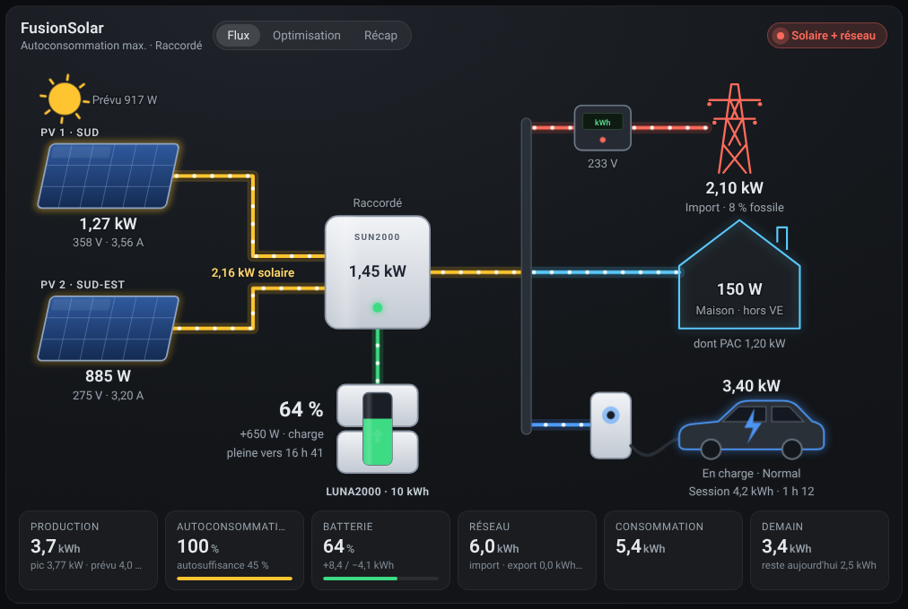
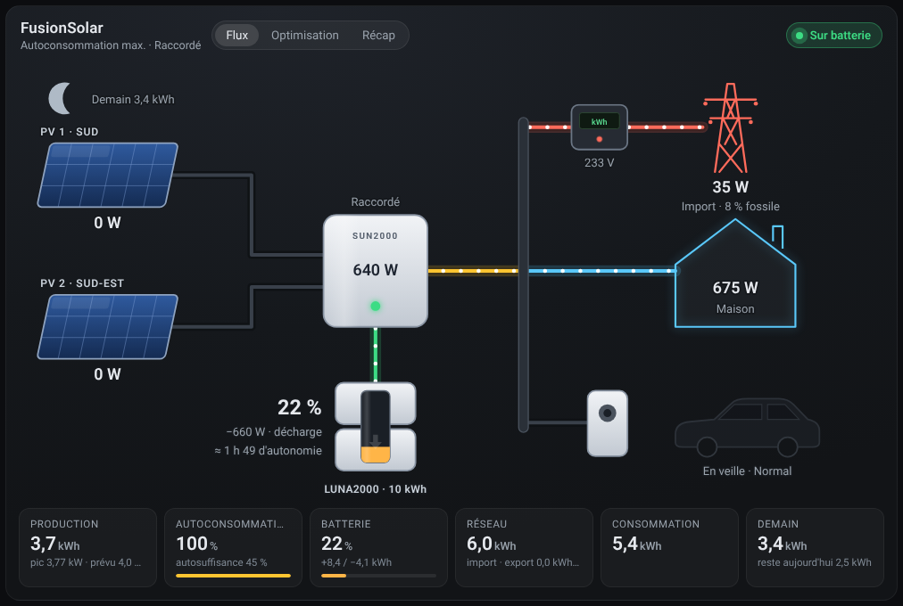
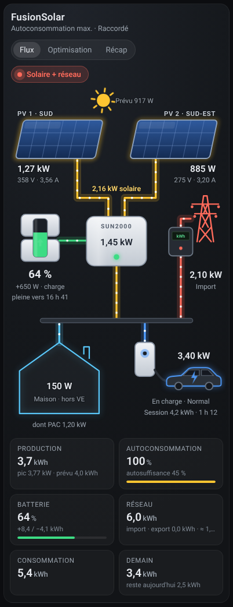
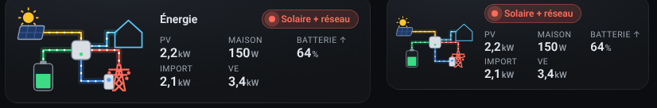
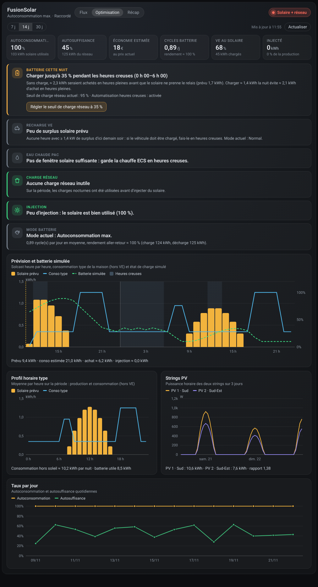
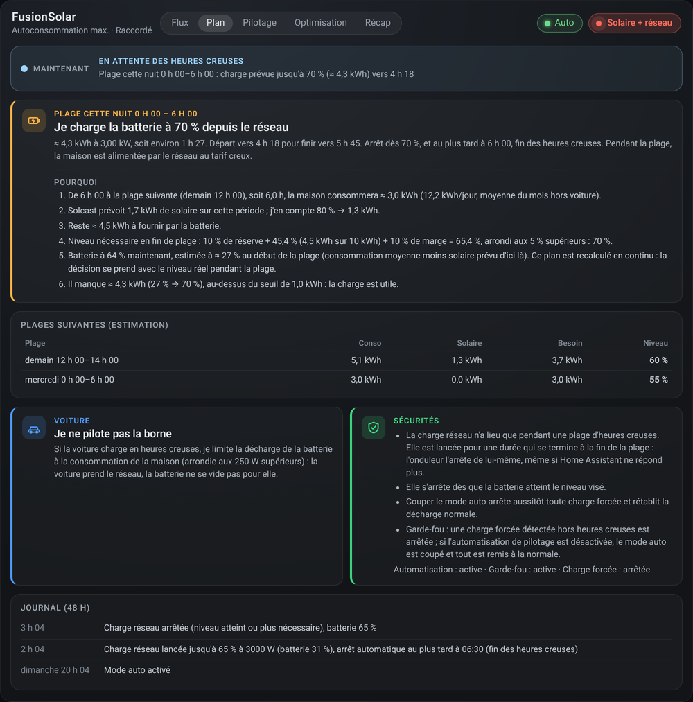
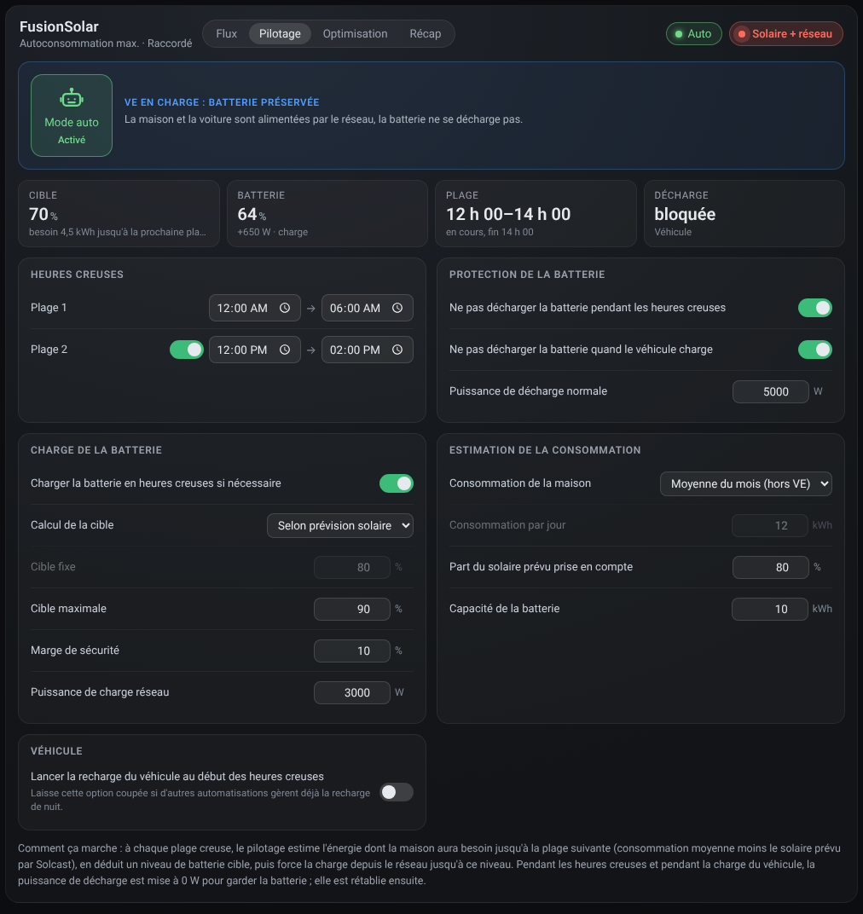
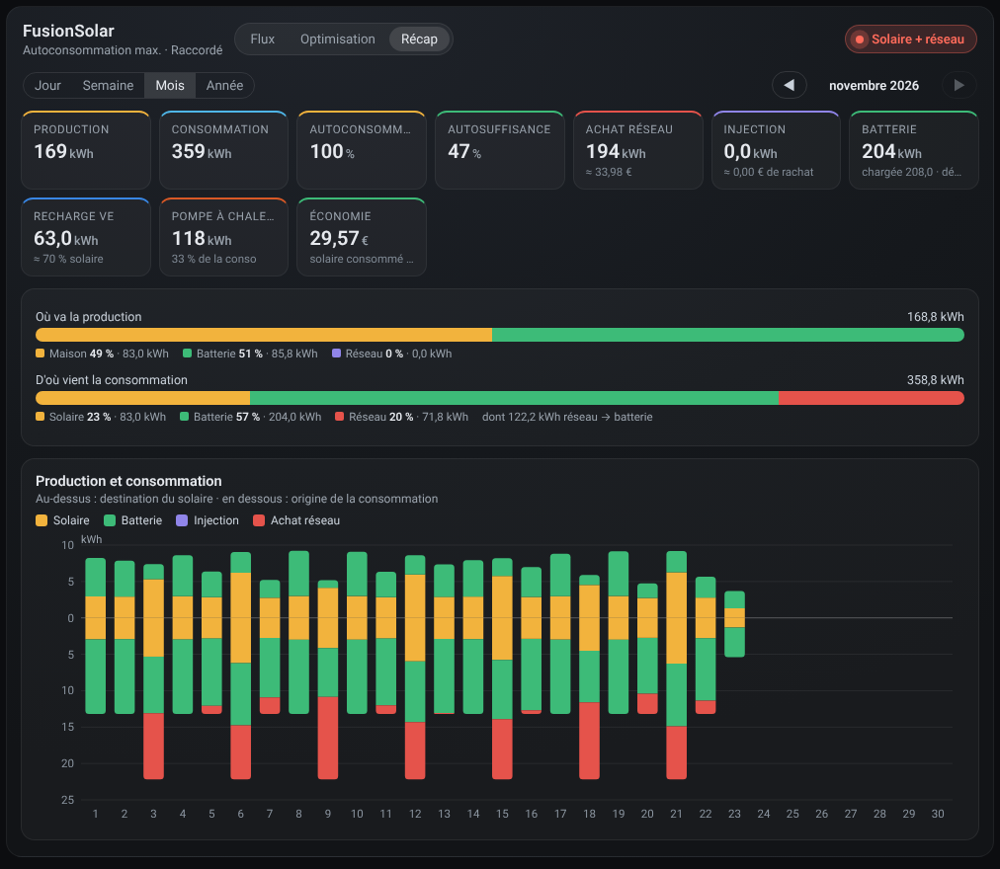
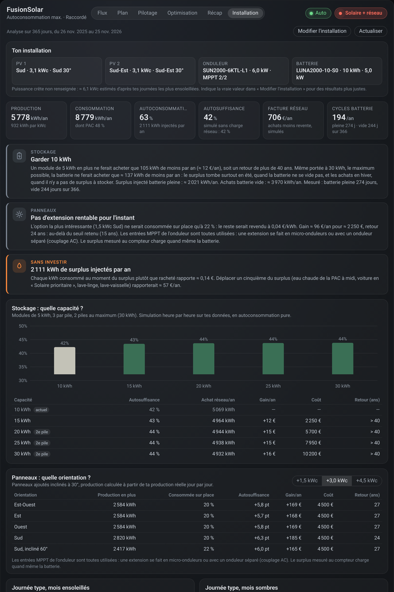

# FusionSolar Card

[](https://hacs.xyz/)
[](https://github.com/Flost42600/fusionsolar-card/releases)
[](LICENSE)

Carte Lovelace animée pour une installation **Huawei FusionSolar** dans Home Assistant (intégrations *Huawei Solar*, *Huawei FusionCharge* et *Solcast*). Même esprit que la [Vitocal Card](https://github.com/Flost42600/vitocal-card) : un schéma animé, un onglet **Optimisation** inspiré d'EMMA et un onglet **Récap** des consommations.

🇬🇧 [English version](README.md)



| Nuit | Smartphone |
|---|---|
|  |  |
| **Mini** | |
|  | |

## Trois cartes

| Type | Usage |
|---|---|
| `custom:fusionsolar-card` | Carte complète. Schéma paysage, bascule seule en portrait sous 620 px. |
| `custom:fusionsolar-phone-card` | Même carte, schéma portrait forcé, tuiles et graphiques sur une colonne. |
| `custom:fusionsolar-mini-card` | Version compacte : solaire, maison, batterie, réseau, VE. |

## Onglet Flux

Deux strings PV (W, V, A), total solaire, onduleur SUN2000 (puissance AC, voyant d'état), batterie LUNA2000 (jauge SOC, charge ou décharge, autonomie ou heure de pleine charge), compteur (tension), réseau (import / export, part fossile), maison (hors VE, dont PAC) et borne FusionCharge (état, mode, session, voiture animée en charge). Les flux s'animent dans le bon sens, à une vitesse proportionnelle à la puissance. Le soleil devient lune la nuit, avec la prévision du lendemain.

Tuiles du jour : production, autoconsommation et autosuffisance, batterie, réseau (avec coût), consommation (dont VE), prévision de demain. Les cumuls du jour viennent des statistiques 5 minutes (rafraîchies toutes les 5 min).

## Onglet Optimisation (inspiré d'EMMA)

EMMA prévoit le surplus solaire, réserve de la place dans la batterie, précharge en heures creuses quand c'est utile et donne la priorité au VE et à la PAC quand il y a du soleil. La carte reproduit cette logique avec tes données :

- **Indicateurs sur 7, 14 ou 30 jours** : autoconsommation, autosuffisance, économie estimée, cycles et rendement batterie, part solaire du VE, énergie injectée.
- **Batterie cette nuit** : simulation heure par heure jusqu'à demain soir (prévision Solcast + consommation type hors VE). La carte teste plusieurs seuils de charge réseau et retient le plus bas qui évite l'achat en heures pleines sans gaspiller le soleil du lendemain. Bouton *Régler le seuil* (`number.inverter_soc_de_coupure_de_charge_reseau`), avec confirmation.
- **Recharge VE** : meilleur créneau de surplus ≥ `ev_min_power`, bouton pour passer la borne en *Solaire prioritaire*.
- **Eau chaude PAC** : créneau conseillé pour la chauffe ECS.
- **Charge réseau inutile** : kWh achetés la nuit puis compensés par de l'injection le lendemain.
- **Injection** : volume, heures du surplus, perte si `export_price` est renseigné.
- **Mode batterie** : mode actuel, et retour en *Autoconsommation max.* proposé hors heures creuses.
- Graphiques : prévision et batterie simulée sur 36 h, profil horaire type, comparaison des deux strings sur 3 jours, taux quotidiens.

Ce sont des règles de bon sens sur une consommation moyenne : vérifie après chaque réglage, et tiens compte des automatisations qui pilotent déjà ta batterie.



## Onglets Plan et Pilotage (mode auto)

Un bouton **Auto** dans l'en-tête, un onglet **Plan** et un onglet **Pilotage** gèrent la batterie en heures creuses. La logique tourne dans Home Assistant (deux automatisations et quelques entrées), la carte sert de tableau de commande : elle fonctionne même navigateur fermé.

**Onglet Plan : ce que le pilotage va faire, et pourquoi.** Pour la plage en cours ou la prochaine, une phrase claire (« Je charge la batterie à 65 % depuis le réseau », « Pas de charge : la batterie suffit »…), l'heure de départ et d'arrêt, puis le raisonnement pas à pas : consommation attendue jusqu'à la plage suivante, solaire prévu par Solcast et part prise en compte, énergie à fournir par la batterie, calcul du niveau nécessaire (réserve + besoin + marge, arrondi), niveau estimé au début de la plage. Suivent une estimation pour les plages suivantes, le comportement quand la voiture charge, les sécurités et le journal des actions des 48 dernières heures. Le bandeau de l'onglet Flux annonce la même décision.

- **Deux plages d'heures creuses** réglables (la seconde peut être coupée).
- **Charge uniquement en heures creuses.** La charge réseau est lancée avec `huawei_solar.forcible_charge` pour une durée qui se termine à la fin de la plage : l'onduleur l'arrête de lui-même, même si Home Assistant ne répond plus. Elle est arrêtée dès que la batterie atteint le niveau visé. Option « Charger en fin de plage » : la charge démarre juste assez tôt pour finir à la fin des heures creuses. Une charge inférieure au seuil « Charge minimale » n'est pas lancée.
- **Le réseau seulement si la batterie ne suffit pas.** Le niveau nécessaire vient de l'énergie dont la maison aura besoin entre la fin de la plage et la plage suivante (consommation moyenne hors VE moins le solaire Solcast pondéré) + marge, plafonné. Au-dessus, la batterie alimente la maison normalement, même en heures creuses : aucun achat. Elle passe la main au réseau (tarif creux) seulement quand elle descend à ce niveau. Cible fixe possible.
- **Voiture en charge : la batterie pour la maison, le réseau pour la voiture.** La carte ne pilote pas la borne. Quand la voiture charge (en heures creuses, ou toujours selon le réglage), la puissance de décharge est limitée à la consommation de la maison (arrondie par 250 W), puis rétablie.
- **Sécurités.** Couper le mode auto arrête aussitôt la charge forcée et rétablit la décharge normale (bouton protégé contre le double-clic). L'automatisation `FusionSolar – Garde-fou pilotage` arrête toute charge forcée détectée hors heures creuses et, si l'automatisation de pilotage est désactivée, coupe le mode auto et remet tout à la normale.
- Quand le mode auto est actif, les anciennes automatisations de charge HC sont désactivées ; elles sont réactivées à l'arrêt.

Entités utilisées (créées dans HA, noms modifiables sous `entities:`) : `input_boolean.fusionsolar_pilotage_auto`, `input_datetime.fusionsolar_hc1_debut|fin`, `input_datetime.fusionsolar_hc2_debut|fin`, `input_boolean.fusionsolar_hc2_active`, `input_boolean.fusionsolar_charge_batterie_hc`, `input_boolean.fusionsolar_preserver_batterie_hc`, `input_boolean.fusionsolar_proteger_batterie_ve`, `input_boolean.fusionsolar_charge_en_fin_de_plage`, `input_select.fusionsolar_cible_mode`, `input_select.fusionsolar_conso_source`, `input_select.fusionsolar_protection_ve_portee`, `input_number.fusionsolar_cible_fixe|cible_max|marge|puissance_charge_reseau|puissance_decharge_normale|conso_jour|facteur_pv|capacite_batterie|charge_minimum`, capteurs template `sensor.fusionsolar_pilotage_besoin|cible|etat|limite_decharge|debut_plage|fin_plage`, `binary_sensor.fusionsolar_pilotage_en_hc|ve_en_charge|bloquer_decharge`, `sensor.maison_hors_ve_mois` et les automatisations `automation.fusionsolar_pilotage_auto_heures_creuses` et `automation.fusionsolar_garde_fou_pilotage`. Les plages du pilotage remplacent alors l'option `offpeak`. Sans ces entités, les onglets sont masqués.





## Onglet Récap

Jour, semaine, mois ou année, avec navigation ◀ ▶ : production, consommation, autoconsommation, autosuffisance, achat réseau (€), injection, batterie, VE (part solaire), PAC, économie. Deux barres « Où va la production » / « D'où vient la consommation », et un graphique miroir (au-dessus la destination du solaire, en dessous l'origine de la consommation). La répartition se fait heure par heure depuis les statistiques long terme. L'énergie de batterie chargée depuis le réseau compte comme du réseau dans l'autosuffisance.



## Onglet Installation (évolution de l'installation)

Propose des évolutions cohérentes avec **ton** installation, à partir de tes 12 derniers mois de statistiques horaires :

- **Ton installation** : strings PV (puissance crête, orientation, inclinaison), onduleur (modèle lu dans Home Assistant, puissance AC, entrées MPPT), batterie (capacité, puissance, modules par pile). Tout se modifie dans l'onglet (bouton *Modifier l'installation*) ; sans puissance crête renseignée, la carte l'estime d'après tes journées les plus ensoleillées. Les réglages restent dans le navigateur et peuvent être copiés en YAML dans l'option `installation:` de la carte.
- **Bilan** : production et consommation annuelles, autoconsommation, autosuffisance, facture réseau, cycles batterie, jours batterie pleine ou vide.
- **Propositions** : stockage (garder la capacité ou ajouter des modules), panneaux (meilleure orientation et puissance), combinaison des deux si elle fait mieux, et ce qu'on peut gagner sans investir en déplaçant les usages vers le surplus.
- **Stockage : quelle capacité ?** : simulation heure par heure de chaque capacité possible (modules de 5 kWh, 3 par pile, 2 piles pour une LUNA2000-S0), avec autosuffisance, achats, gain annuel, coût et retour.
- **Panneaux : quelle orientation ?** : Est-Ouest, Est, Ouest, Sud et Sud incliné à 60° (production d'hiver), pour trois puissances ajoutées.
- **Combinaisons** panneaux × stockage, **journées types** (mois ensoleillés et sombres) et **autosuffisance par mois**.

Méthode : la production des panneaux ajoutés suit ta production réelle de chaque journée (même météo), répartie selon la course du soleil à ta position pour l'orientation choisie. La batterie est simulée en autoconsommation pure avec le rendement mesuré. Une option est retenue si elle se rembourse en moins de 60 % de sa durée de vie. Prix d'achat HP/HC, revente, coûts au kWc et au kWh se règlent dans l'onglet. C'est un ordre de grandeur pour comparer les options, pas une étude d'installateur.



## Installation

**HACS** : HACS → ⋮ → **Dépôts personnalisés** → `https://github.com/Flost42600/fusionsolar-card`, catégorie **Tableau de bord** → **FusionSolar Card** → Télécharger, puis recharger le navigateur.

**Manuelle** : copier `fusionsolar-card.js` dans `/config/www/`, ajouter la ressource `/local/fusionsolar-card.js` (Module JavaScript), recharger le navigateur.

## Configuration

```yaml
type: custom:fusionsolar-card
title: FusionSolar
battery_capacity: 10
pv1_name: Sud          # nom affiché du string 1
pv2_name: Sud-Est
offpeak:               # tes heures creuses
  - "00:00-06:00"
  - "12:00-14:00"
export_price: 0.04     # optionnel, €/kWh
ev_min_power: 1400     # W : surplus minimum pour charger le VE
```

```yaml
type: custom:fusionsolar-phone-card
pv1_name: Sud
pv2_name: Sud-Est
offpeak: ["00:00-06:00", "12:00-14:00"]
```

```yaml
type: custom:fusionsolar-mini-card
navigation_path: /lovelace/energie   # optionnel
```

Autres options : `show_pilot` (onglets Plan et Pilotage), `show_sizing` (onglet Installation), `installation` (description de l'installation, voir l'onglet), `layout` (auto, wide, tall), `optimization_days` (7, 14, 30), `pv1_peak` / `pv2_peak` (W, intensité du halo), `heatpump_min_power`, `grid_invert`, `battery_invert`, `show_header`, `show_stats`, `show_optimization`, `show_recap`, `language` (fr, en).

### Conventions et entités

- Compteur : puissance **positive = injection** (convention Huawei). Batterie : **positive = charge**. Sinon `grid_invert: true` / `battery_invert: true`.
- Maison = puissance AC onduleur − compteur ; maison hors VE = maison − borne.
- Toute entité se remplace sous `entities:` (une liste est acceptée pour les énergies, ex. PAC chauffage + ECS) :

```yaml
entities:
  pv_energy: sensor.production_solaire_reelle
  grid_import_energy: sensor.power_meter_consommation
  grid_export_energy: sensor.power_meter_exporte
  battery_charge_energy: sensor.batteries_charge_cumulee
  battery_discharge_energy: sensor.batteries_decharge_cumulee
  ev_energy: sensor.garage_ns2661082995_energie_totale
  heatpump_energy:
    - sensor.e3_vitocal_heating_energy_consumption_this_year
    - sensor.e3_vitocal_dhw_energy_consumption_this_year
  heatpump_power: null     # null = masquer
```

Clés disponibles : `pv1_power`, `pv2_power`, `pv1_voltage`, `pv1_current`, `pv2_voltage`, `pv2_current`, `pv_power`, `inverter_power`, `inverter_state`, `inverter_alarm`, `pv_daily`, `pv_peak`, `battery_soc`, `battery_power`, `battery_mode`, `battery_charge_today`, `battery_discharge_today`, `battery_end_soc`, `battery_max_soc`, `battery_grid_cutoff_soc`, `battery_grid_charge_power`, `battery_forced_charge`, `grid_power`, `grid_voltage`, `ev_power`, `ev_state`, `ev_plugged`, `ev_mode`, `ev_session_energy`, `ev_session_duration`, `ev_online`, `heatpump_power`, `price`, `fossil`, `sun`, `hc_toggle`, `forecast_today`, `forecast_tomorrow`, `forecast_remaining`, `forecast_now`, plus les énergies ci-dessus.

## Licence

MIT
