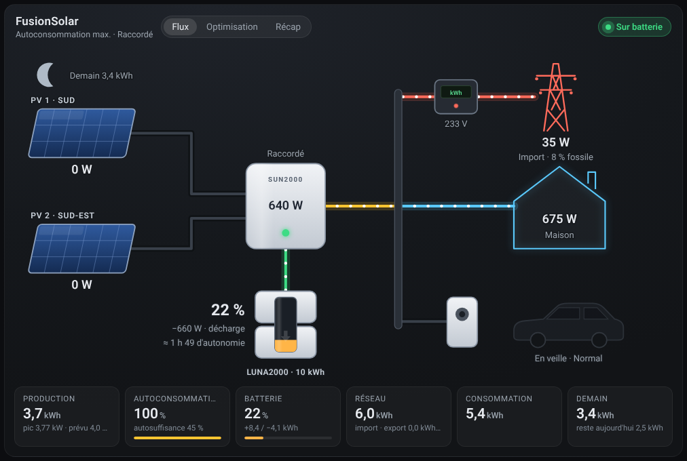

# FusionSolar Card

[](https://hacs.xyz/)
[](https://github.com/Flost42600/fusionsolar-card/releases)

[](LICENSE)

Animated Lovelace card for **Huawei FusionSolar** installations in Home Assistant, built on the *Huawei Solar*, *Huawei FusionCharge* and *Solcast* integrations. Same spirit as the [Vitocal Card](https://github.com/Flost42600/vitocal-card): a live diagram, an **Optimization** tab inspired by Huawei EMMA and a **Summary** tab for consumption.

🇫🇷 [Version française](README.fr.md)


| Night | Phone |
|---|---|
|  |  |
| **Mini** | |
|  | |

## Three cards

| Type | Use |
|---|---|
| `custom:fusionsolar-card` | Full card. Landscape diagram, switches to portrait below 620 px. |
| `custom:fusionsolar-phone-card` | Same card with the portrait diagram forced, single-column tiles and charts. |
| `custom:fusionsolar-mini-card` | Compact version: solar, home, battery, grid, EV. |

## Flow tab

Two PV strings (W, V, A) and total solar, SUN2000 inverter (AC power, status LED), LUNA2000 battery (SOC gauge, charging or discharging, time left or time to full), power meter (voltage), grid (import/export, fossil share), home (excluding EV, heat pump share) and FusionCharge charger (state, mode, session, animated car while charging). Flows animate in the right direction at a speed that follows the power. The sun turns into a moon at night, with tomorrow's forecast.

Daily tiles: production, self-consumption and self-sufficiency, battery, grid (with cost), consumption (incl. EV), tomorrow's forecast. Daily totals come from 5-minute statistics, refreshed every 5 minutes.

## Optimization tab (inspired by EMMA)

EMMA forecasts PV surplus, reserves battery room for it, pre-charges off-peak only when useful and gives solar priority to the EV charger and heat pump. The card applies the same logic to your data:

- **KPIs over 7, 14 or 30 days**: self-consumption, self-sufficiency, estimated savings, battery cycles and efficiency, EV solar share, exported energy.
- **Battery tonight**: hour-by-hour simulation until tomorrow night (Solcast forecast + typical home load excluding EV). The card tries several grid-charge cut-off levels and keeps the lowest one that avoids peak-rate purchases without wasting tomorrow's sun. *Set cut-off* button (`battery_grid_cutoff_soc`), with confirmation.
- **EV charging**: best surplus window ≥ `ev_min_power`, button to switch the charger to *PV preferred*.
- **Heat pump hot water**: suggested window for DHW heating.
- **Wasted grid charging**: kWh bought overnight then offset by export the next day.
- **Export**: volume, surplus hours, loss when `export_price` is set.
- **Battery mode**: current mode, with a switch back to *Max. self-consumption* offered outside off-peak hours.
- Charts: 36 h forecast with simulated battery, typical hourly profile, comparison of the two strings over 3 days, daily rates.

These are common-sense rules based on average consumption: check the result after each change, and keep in mind any automation that already drives your battery.


## Control tab (auto mode)

An **Auto** button in the header and a **Control** tab drive the battery and charging during off-peak hours. The logic runs in Home Assistant (one automation and a few helpers); the card is the control panel, so it keeps working with the browser closed.

- **Two adjustable off-peak windows** (the second one can be turned off).
- **Battery charging when needed**: for each window, the need until the next window is estimated (average home consumption excluding EV minus weighted Solcast solar), turned into a target level (+ margin, capped), then the battery is charged from the grid up to that level (`huawei_solar.forcible_charge_soc`). A fixed target is also possible.
- **Battery preserved** during off-peak hours: the home runs on cheap grid power and the battery is kept for peak hours.
- **Battery protected while the EV charges**: discharge power is set to 0 W while the car charges, then restored.
- **EV charging off-peak** (option): switches the charger to normal charging at the start of the window and back to PV preferred at the end.
- While auto mode is on, the old off-peak charging automations are disabled; they are re-enabled when it is turned off.

The helpers, template sensors and the automation are listed in the [French README](README.fr.md#onglet-pilotage-mode-auto); their names can be overridden under `entities:`. The control windows then replace the `offpeak` option. Without these entities the tab is hidden.


## Summary tab

Day, week, month or year, with ◀ ▶ navigation: production, consumption, self-consumption, self-sufficiency, grid purchase (€), export, battery, EV (solar share), heat pump, savings. Two bars show where production goes and where consumption comes from, plus a mirrored chart (above: where solar goes, below: where consumption comes from). The split is computed hour by hour from long-term statistics. Battery energy charged from the grid counts as grid in self-sufficiency.


## Installation

**HACS**: HACS → ⋮ → **Custom repositories** → `https://github.com/Flost42600/fusionsolar-card`, category **Dashboard** → **FusionSolar Card** → Download, then reload your browser.

**Manual**: copy `fusionsolar-card.js` to `/config/www/`, add the resource `/local/fusionsolar-card.js` (JavaScript module), reload.

## Configuration

```yaml
type: custom:fusionsolar-card
title: FusionSolar
battery_capacity: 10       # kWh
pv1_name: South            # label for string 1
pv2_name: South-East
offpeak:                   # your off-peak hours
  - "00:00-06:00"
  - "12:00-14:00"
export_price: 0.04         # optional, €/kWh
ev_min_power: 1400         # W: minimum surplus to charge the EV
```

```yaml
type: custom:fusionsolar-phone-card
pv1_name: South
pv2_name: South-East
offpeak: ["00:00-06:00", "12:00-14:00"]
```

```yaml
type: custom:fusionsolar-mini-card
navigation_path: /lovelace/energy   # optional
```

Other options: `show_pilot`, `layout` (auto, wide, tall), `optimization_days` (7, 14, 30), `pv1_peak` / `pv2_peak` (W, glow intensity), `heatpump_min_power`, `grid_invert`, `battery_invert`, `show_header`, `show_stats`, `show_optimization`, `show_recap`, `language` (fr, en).

### Conventions and entities

- Power meter: **positive = export** (Huawei convention). Battery: **positive = charging**. Otherwise set `grid_invert: true` / `battery_invert: true`.
- Home = inverter AC power − meter; home excluding EV = home − charger.
- Default entity IDs match a French-language *Huawei Solar* setup; missing ones are looked up by `translation_key` when possible. Override any of them under `entities:` (energy keys accept a list, e.g. heat pump heating + DHW):

```yaml
entities:
  pv_energy: sensor.solar_energy
  grid_import_energy: sensor.power_meter_consumption
  grid_export_energy: sensor.power_meter_exported
  battery_charge_energy: sensor.battery_total_charge
  battery_discharge_energy: sensor.battery_total_discharge
  ev_energy: sensor.charger_total_energy
  heatpump_energy:
    - sensor.heat_pump_heating_energy
    - sensor.heat_pump_dhw_energy
  heatpump_power: null       # null = hide
```

Available keys: `pv1_power`, `pv2_power`, `pv1_voltage`, `pv1_current`, `pv2_voltage`, `pv2_current`, `pv_power`, `inverter_power`, `inverter_state`, `inverter_alarm`, `pv_daily`, `pv_peak`, `battery_soc`, `battery_power`, `battery_mode`, `battery_charge_today`, `battery_discharge_today`, `battery_end_soc`, `battery_max_soc`, `battery_grid_cutoff_soc`, `battery_grid_charge_power`, `battery_forced_charge`, `grid_power`, `grid_voltage`, `ev_power`, `ev_state`, `ev_plugged`, `ev_mode`, `ev_session_energy`, `ev_session_duration`, `ev_online`, `heatpump_power`, `price`, `fossil`, `sun`, `hc_toggle`, `forecast_today`, `forecast_tomorrow`, `forecast_remaining`, `forecast_now`, plus the energy keys above.

## License

[MIT](LICENSE)
