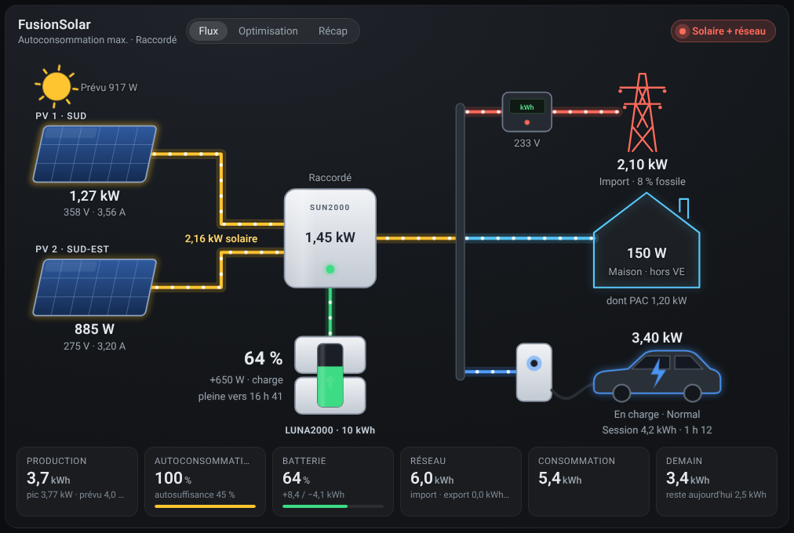
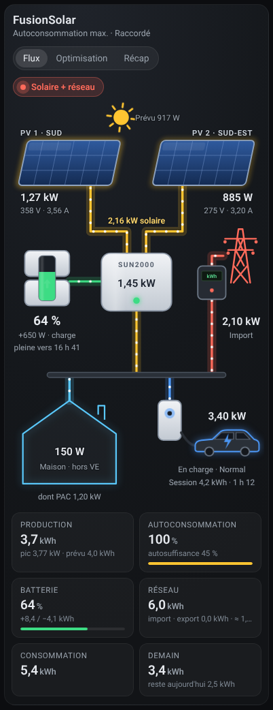
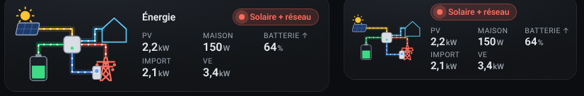
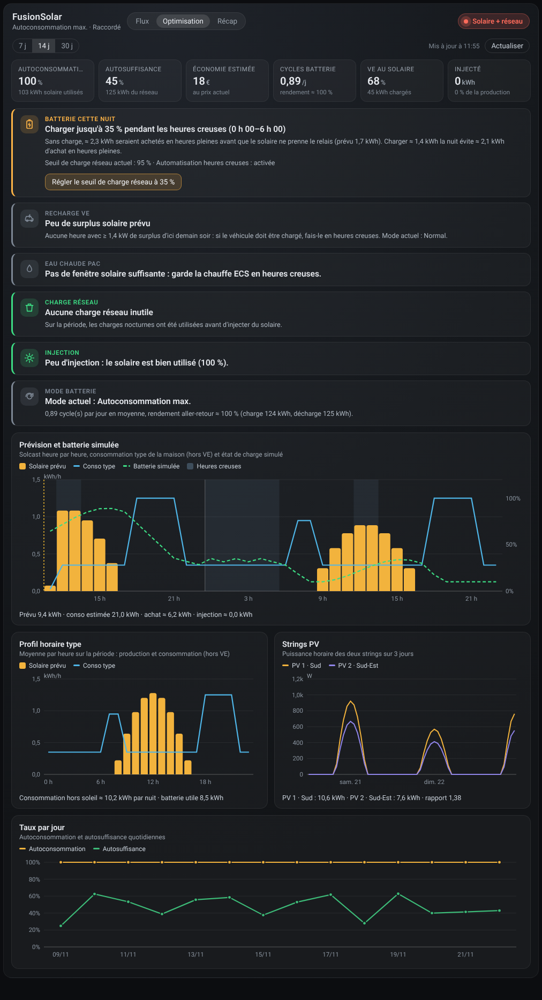
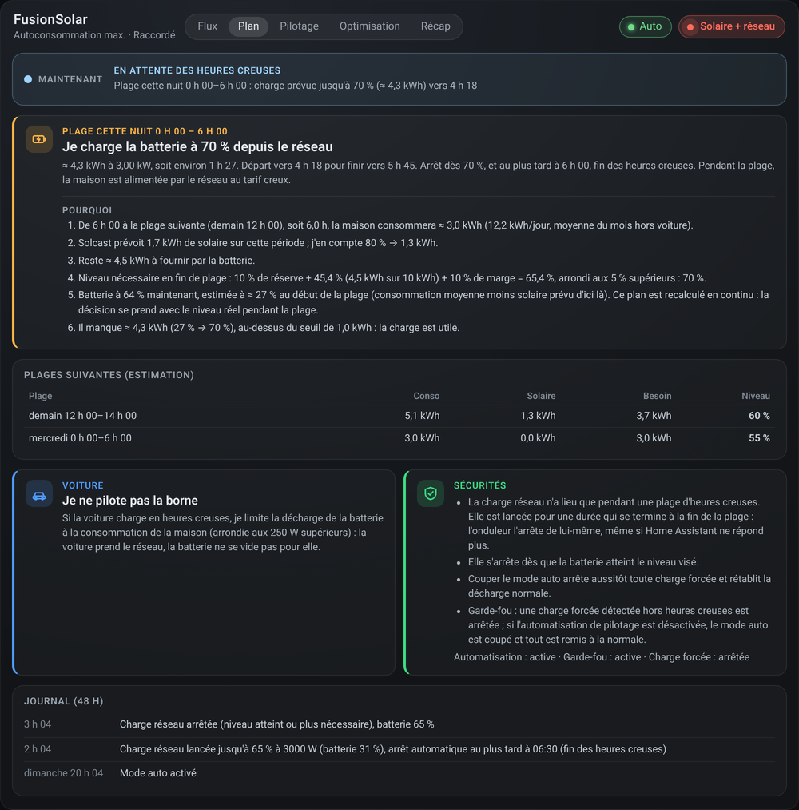
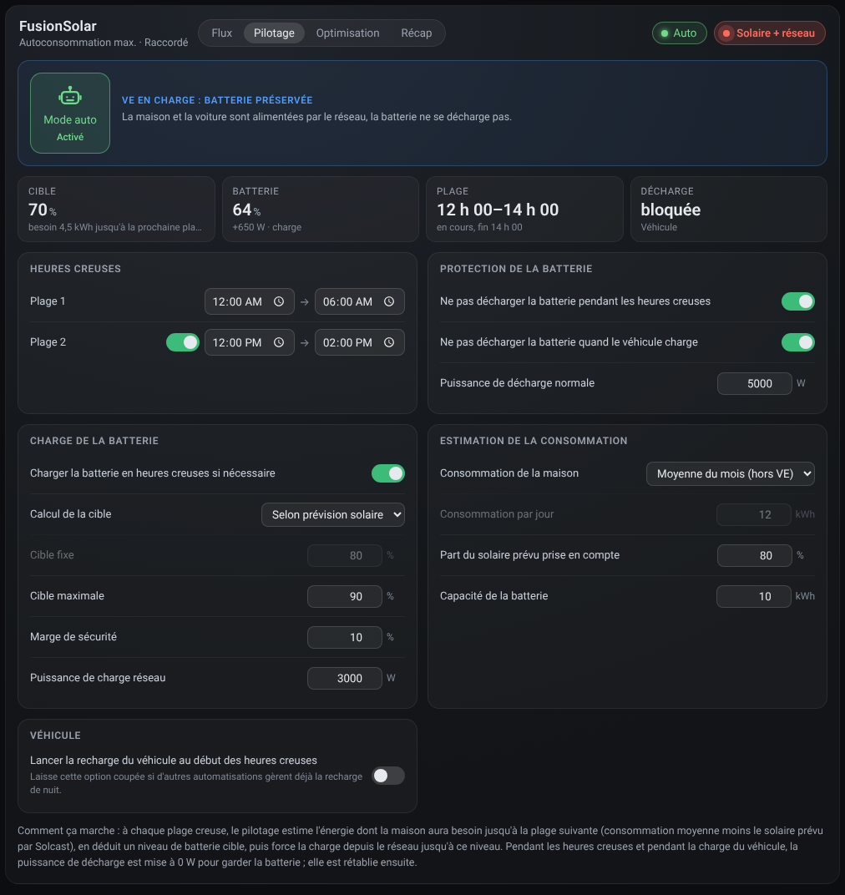
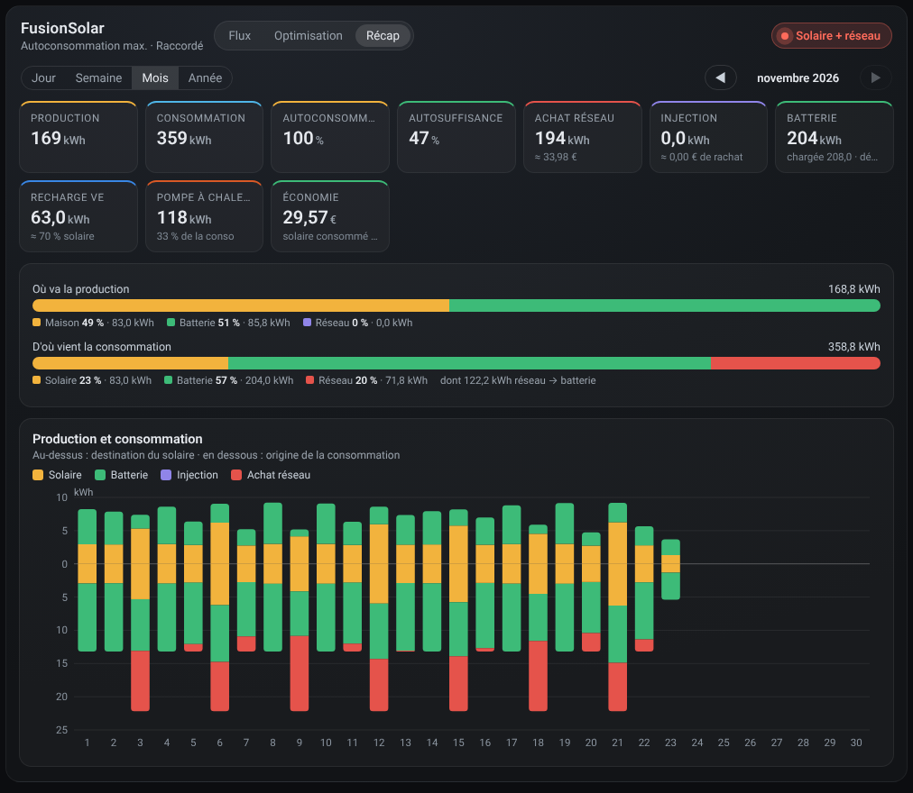
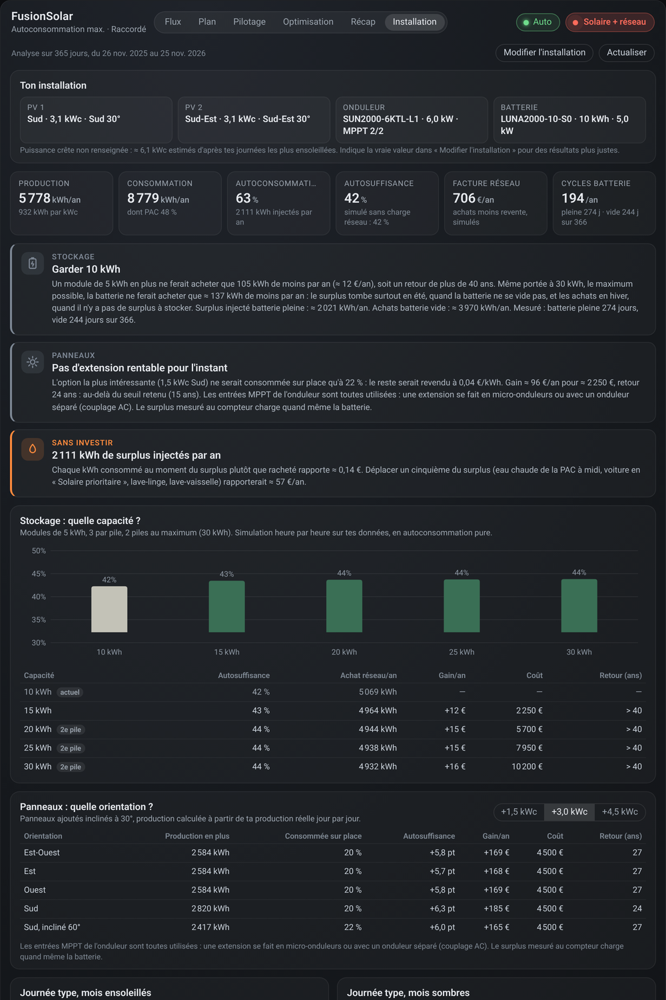

# FusionSolar Card

[](https://hacs.xyz/)
[](https://github.com/Flost42600/fusionsolar-card/releases)

[](LICENSE)

Animated Lovelace card for **Huawei FusionSolar** installations in Home Assistant, built on the *Huawei Solar*, *Huawei FusionCharge* and *Solcast* integrations. Same spirit as the [Vitocal Card](https://github.com/Flost42600/vitocal-card): a live diagram, an **Optimization** tab inspired by Huawei EMMA and a **Summary** tab for consumption.

🇫🇷 [Version française](README.fr.md)



| Night | Phone |
|---|---|
|  |  |
| **Mini** | |
|  | |

## Three cards

| Type | Use |
|---|---|
| `custom:fusionsolar-card` | Full card. Landscape diagram, switches to portrait below 620 px. |
| `custom:fusionsolar-phone-card` | Same card with the portrait diagram forced, single-column tiles and charts. |
| `custom:fusionsolar-mini-card` | Compact version: solar, home, battery, grid, EV. |

## Flow tab

Two PV strings (W, V, A) and total solar, SUN2000 inverter (AC power, status LED), LUNA2000 battery (SOC gauge, charging or discharging, time left or time to full), power meter (voltage), grid (import/export, fossil share), home (excluding EV, heat pump share) and FusionCharge charger (state, mode, session, animated car while charging). Flows animate in the right direction at a speed that follows the power. The sun turns into a moon at night, with tomorrow's forecast.

Daily tiles: production, self-consumption and self-sufficiency, battery, grid (with cost), consumption (incl. EV), tomorrow's forecast. Daily totals come from 5-minute statistics, refreshed every 5 minutes.

## Optimization tab (inspired by EMMA)

EMMA forecasts PV surplus, reserves battery room for it, pre-charges off-peak only when useful and gives solar priority to the EV charger and heat pump. The card applies the same logic to your data:

- **KPIs over 7, 14 or 30 days**: self-consumption, self-sufficiency, estimated savings, battery cycles and efficiency, EV solar share, exported energy.
- **Battery tonight**: hour-by-hour simulation until tomorrow night (Solcast forecast + typical home load excluding EV). The card tries several grid-charge cut-off levels and keeps the lowest one that avoids peak-rate purchases without wasting tomorrow's sun. *Set cut-off* button (`battery_grid_cutoff_soc`), with confirmation.
- **EV charging**: best surplus window ≥ `ev_min_power`, button to switch the charger to *PV preferred*.
- **Heat pump hot water**: suggested window for DHW heating.
- **Wasted grid charging**: kWh bought overnight then offset by export the next day.
- **Export**: volume, surplus hours, loss when `export_price` is set.
- **Battery mode**: current mode, with a switch back to *Max. self-consumption* offered outside off-peak hours.
- Charts: 36 h forecast with simulated battery, typical hourly profile, comparison of the two strings over 3 days, daily rates.

These are common-sense rules based on average consumption: check the result after each change, and keep in mind any automation that already drives your battery.



## Plan and Control tabs (auto mode)

An **Auto** button in the header, a **Plan** tab and a **Control** tab manage the battery during off-peak hours. The logic runs in Home Assistant (two automations and a few helpers); the card is the control panel, so it keeps working with the browser closed.

**Plan tab: what the control will do, and why.** For the current or next window, a plain sentence ("I will charge the battery to 65% from the grid", "No charging: the battery is enough"…), start and stop times, then the reasoning step by step: expected consumption until the next window, Solcast solar forecast and the share counted, energy the battery must supply, how the level needed is computed (reserve + need + margin, rounded), expected level at the start of the window. Below: an estimate for the next windows, what happens when the car charges, the safeguards and a log of the last 48 hours of actions. The banner on the Flow tab announces the same decision.

- **Two adjustable off-peak windows** (the second one can be turned off).
- **Charging only during off-peak hours.** Grid charging is started with `huawei_solar.forcible_charge` for a duration that ends with the window, so the inverter stops it by itself even if Home Assistant stops responding. It is stopped as soon as the battery reaches the target. "Charge at the end of the window" option: charging starts just early enough to finish when off-peak hours end. A charge smaller than the "Minimum charge" threshold is not started.
- **Grid only when the battery is not enough.** The level needed comes from the energy the home will need between the end of the window and the next one (average consumption excluding EV minus weighted Solcast solar) + margin, capped. Above it the battery powers the home as usual, even off-peak: nothing is bought. It hands over to the (off-peak) grid only when it drops to that level. A fixed target is also possible.
- **Car charging: battery for the home, grid for the car.** The card does not control the charger. While the car charges (off-peak, or always depending on the setting), discharge power is limited to the home's consumption (rounded up to 250 W), then restored.
- **Safeguards.** Turning auto mode off immediately stops forced charging and restores normal discharge (the button ignores double clicks). The `FusionSolar – Garde-fou pilotage` automation stops any forced charge found outside off-peak hours and, if the control automation is disabled, turns auto mode off and resets everything.
- While auto mode is on, the old off-peak charging automations are disabled; they are re-enabled when it is turned off.

The helpers, template sensors and automations are listed in the [French README](README.fr.md#onglets-plan-et-pilotage-mode-auto); their names can be overridden under `entities:`. The control windows then replace the `offpeak` option. Without these entities the tabs are hidden.





## Summary tab

Day, week, month or year, with ◀ ▶ navigation: production, consumption, self-consumption, self-sufficiency, grid purchase (€), export, battery, EV (solar share), heat pump, savings. Two bars show where production goes and where consumption comes from, plus a mirrored chart (above: where solar goes, below: where consumption comes from). The split is computed hour by hour from long-term statistics. Battery energy charged from the grid counts as grid in self-sufficiency.



## Installation tab (upgrade planning)

Suggests upgrades that fit **your** installation, from the last 12 months of hourly statistics:

- **Your installation**: PV strings (peak power, orientation, tilt), inverter (model read from Home Assistant, AC power, MPPT inputs), battery (capacity, power, modules per stack). Everything can be edited in the tab (*Edit installation*); without a peak power, the card estimates it from your sunniest days. Settings stay in the browser and can be copied as YAML into the card's `installation:` option.
- **Summary**: yearly production and consumption, self-consumption, self-sufficiency, grid bill, battery cycles, days with a full or empty battery.
- **Suggestions**: storage (keep the capacity or add modules), panels (best orientation and size), both combined when that does better, and what shifting usage to the surplus saves without investing.
- **Storage: what capacity?**: hour-by-hour simulation of every possible capacity (5 kWh modules, 3 per stack, 2 stacks for a LUNA2000-S0) with self-sufficiency, purchases, yearly gain, cost and payback.
- **Panels: which orientation?**: East-West, East, West, South and South at 60° tilt (winter production), for three added sizes.
- Panels × storage **combinations**, **typical days** (sunny and dark months) and **self-sufficiency by month**.

Method: added panels follow your actual production each day (same weather), spread along the sun's path at your location for the chosen orientation. The battery is simulated in pure self-consumption with its measured efficiency. An option is kept if it pays back within 60% of its lifetime. Peak/off-peak prices, feed-in price and costs per kWp and kWh are set in the tab. This is an order of magnitude to compare options, not an installer's study.



## Installation

**HACS**: HACS → ⋮ → **Custom repositories** → `https://github.com/Flost42600/fusionsolar-card`, category **Dashboard** → **FusionSolar Card** → Download, then reload your browser.

**Manual**: copy `fusionsolar-card.js` to `/config/www/`, add the resource `/local/fusionsolar-card.js` (JavaScript module), reload.

## Configuration

```yaml
type: custom:fusionsolar-card
title: FusionSolar
battery_capacity: 10       # kWh
pv1_name: South            # label for string 1
pv2_name: South-East
offpeak:                   # your off-peak hours
  - "00:00-06:00"
  - "12:00-14:00"
export_price: 0.04         # optional, €/kWh
ev_min_power: 1400         # W: minimum surplus to charge the EV
```

```yaml
type: custom:fusionsolar-phone-card
pv1_name: South
pv2_name: South-East
offpeak: ["00:00-06:00", "12:00-14:00"]
```

```yaml
type: custom:fusionsolar-mini-card
navigation_path: /lovelace/energy   # optional
```

Other options: `show_pilot` (Plan and Control tabs), `show_sizing` (Installation tab), `installation` (installation description, see the tab), `layout` (auto, wide, tall), `optimization_days` (7, 14, 30), `pv1_peak` / `pv2_peak` (W, glow intensity), `heatpump_min_power`, `grid_invert`, `battery_invert`, `show_header`, `show_stats`, `show_optimization`, `show_recap`, `language` (fr, en).

### Conventions and entities

- Power meter: **positive = export** (Huawei convention). Battery: **positive = charging**. Otherwise set `grid_invert: true` / `battery_invert: true`.
- Home = inverter AC power − meter; home excluding EV = home − charger.
- Default entity IDs match a French-language *Huawei Solar* setup; missing ones are looked up by `translation_key` when possible. Override any of them under `entities:` (energy keys accept a list, e.g. heat pump heating + DHW):

```yaml
entities:
  pv_energy: sensor.solar_energy
  grid_import_energy: sensor.power_meter_consumption
  grid_export_energy: sensor.power_meter_exported
  battery_charge_energy: sensor.battery_total_charge
  battery_discharge_energy: sensor.battery_total_discharge
  ev_energy: sensor.charger_total_energy
  heatpump_energy:
    - sensor.heat_pump_heating_energy
    - sensor.heat_pump_dhw_energy
  heatpump_power: null       # null = hide
```

Available keys: `pv1_power`, `pv2_power`, `pv1_voltage`, `pv1_current`, `pv2_voltage`, `pv2_current`, `pv_power`, `inverter_power`, `inverter_state`, `inverter_alarm`, `pv_daily`, `pv_peak`, `battery_soc`, `battery_power`, `battery_mode`, `battery_charge_today`, `battery_discharge_today`, `battery_end_soc`, `battery_max_soc`, `battery_grid_cutoff_soc`, `battery_grid_charge_power`, `battery_forced_charge`, `grid_power`, `grid_voltage`, `ev_power`, `ev_state`, `ev_plugged`, `ev_mode`, `ev_session_energy`, `ev_session_duration`, `ev_online`, `heatpump_power`, `price`, `fossil`, `sun`, `hc_toggle`, `forecast_today`, `forecast_tomorrow`, `forecast_remaining`, `forecast_now`, plus the energy keys above.

## License

[MIT](LICENSE)
